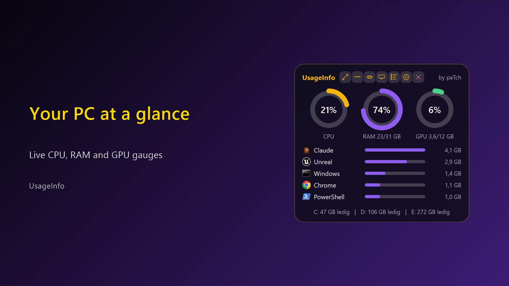
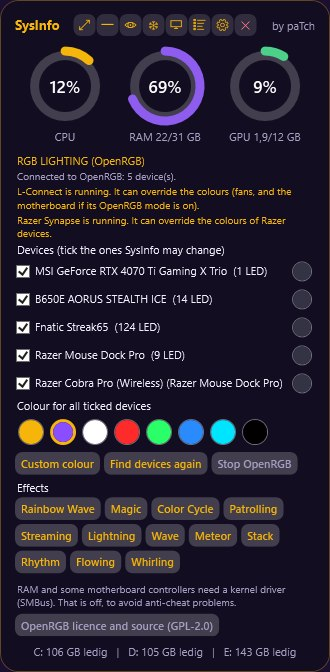

# Usage info

A small, always-on-top Windows widget that shows **CPU, memory, GPU and disk use**, by paTch / Final Patch Studios. Free.



## Download

Get the latest version under **[Releases](../../releases)**:

| File | What it is |
|---|---|
| `UsageInfo-1.1.0-Setup.exe` | Installer. Installs for your user only, adds a Start menu shortcut and an uninstall entry. No administrator rights needed. |
| `UsageInfo-1.1.0-portable.zip` | Portable. Unzip anywhere and double-click `UsageInfo.exe`. Delete the folder to remove it. |

Needs Windows 10 or 11, 64-bit. The interface is partly in Norwegian.

### "Windows protected your PC"

The files are **not code-signed** yet, so Windows SmartScreen may warn that the publisher is unknown. Click **More info → Run anyway**. You can check that the download is intact by comparing its SHA256 checksum with `SHA256SUMS.txt` in the release:

```powershell
Get-FileHash .\UsageInfo-1.1.0-Setup.exe -Algorithm SHA256
```

## Features

- CPU, RAM, GPU and disk use, with normal, expanded and compact modes, and an invisible-background mode.
- Programs using the most memory, with a list of installed programs.
- Quick screen-resolution switch that goes back by itself unless you press Keep.
- Taskbar options: auto-hide, or show the taskbar only while the Windows key is held. Off by default.
- Empty shader cache for NVIDIA, AMD and Intel, only when you click and confirm.
- Check latest updates for your apps through winget. Developer tools are never updated without an extra warning.
- **RGB lighting** (new in 1.1.0), see below.

## RGB lighting



The **SYS** button → **RGB LIGHTING** controls USB RGB devices (motherboard, graphics card, keyboards, mice and more) through the bundled [OpenRGB](https://gitlab.com/CalcProgrammer1/OpenRGB):

- Device list with a tick box per device, one colour for all, a colour per device, effects and a custom colour picker.
- OpenRGB runs as a separate hidden process that listens only on `127.0.0.1`. It starts when you open the menu and stops when Usage info closes.
- **No kernel driver.** RAM and some motherboard controllers need one (SMBus), so they cannot be controlled. This is left out on purpose to avoid anti-cheat problems in games.
- Devices OpenRGB does not support (for example Lian Li wireless fans) stay with their own app. If L-Connect, Razer Synapse or similar apps are running, they may override the colours.

## Questions and bug reports

Open an issue: <https://github.com/paTchPeters/UsageInfo/issues>. This is also where you can ask for the OpenRGB source code (see the written offer in THIRD_PARTY_NOTICES.txt).

## Licence

Usage info is free to use and share unchanged. See [LICENSE.txt](LICENSE.txt).

It includes **OpenRGB** (© Adam Honse and the OpenRGB contributors, **GNU GPL version 2**), unmodified, plus Qt 6.8.3 (LGPL-3.0), libusb (LGPL-2.1) and hidapi (BSD). Source code and the written offer are in [THIRD_PARTY_NOTICES.txt](THIRD_PARTY_NOTICES.txt). The bundled OpenRGB source code is at <https://gitlab.com/CalcProgrammer1/OpenRGB/-/tree/8e16de27858cf2be6af54a33ce003df74cb9fd3e>.

### Questions and bug reports

Open an issue: <https://github.com/paTchPeters/UsageInfo/issues>. This is also where you can ask for the OpenRGB source code (see the written offer in THIRD_PARTY_NOTICES.txt).

## Licence texts and source archive

The full licence texts are in [licenses/](licenses) and inside the app folder (`verktoy\OpenRGB-sysinfo\licenses`). The table shows each file, where it came from (downloaded 2026-11-13) and its SHA256:

| File | Source | Bytes | SHA256 |
|---|---|---|---|
| `licenses/GPL-2.0.txt` | gnu.org/licenses/old-licenses/gpl-2.0.txt | 17984 | `edaef632cbb643e4e7a221717a6c441a4c1a7c918e6e4d56debc3d8739b233f6` |
| `licenses/GPL-3.0.txt` | gnu.org/licenses/gpl-3.0.txt | 35149 | `3972dc9744f6499f0f9b2dbf76696f2ae7ad8af9b23dde66d6af86c9dfb36986` |
| `licenses/LGPL-3.0.txt` | gnu.org/licenses/lgpl-3.0.txt | 7652 | `e3a994d82e644b03a792a930f574002658412f62407f5fee083f2555c5f23118` |
| `licenses/LGPL-2.1.txt` | gnu.org/licenses/old-licenses/lgpl-2.1.txt | 26419 | `20e50fe7aae3e56378ebf0417d9de904f55a0e61e4df315333e632a4d3555d95` |
| `licenses/hidapi-BSD-3-Clause.txt` | github.com/libusb/hidapi (LICENSE-bsd.txt) | 1534 | `30eb1bef29b46f8ba7ab8b416035dbd93cb034a45481dd97815b944284582cd2` |
| `OpenRGB-8e16de27858cf2be6af54a33ce003df74cb9fd3e-source.zip` | github.com/CalcProgrammer1/OpenRGB (the OpenRGB author's mirror), same commit | 17076269 | `064fd11d18ff0cc854c2da0f0b8ee703b4a053089b0cc0cf2e8b925dde7276d8` |

The OpenRGB source archive is kept by Final Patch Studios to honour the written offer, and can be attached to the release on request.
